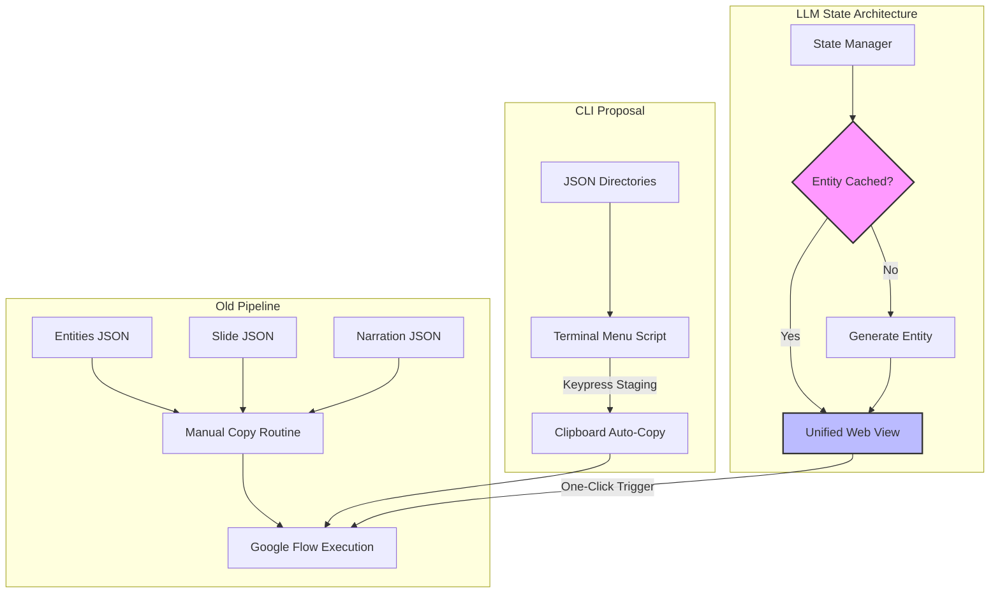

# Don't Just Ask 'How', Ask 'What If': Letting AI Rethink Your Workflows

> Takeaway: Brainstorming system goals with an LLM replaces fragile manual copy routines with state-managed interfaces that eliminate workflow friction.

*Caption: Comparing manual calculation tools to modern calculators illustrates how state automation accelerates workflow execution.*

Generating production comics with generative AI models requires coordinating multiple interdependent prompts across three separate JSON files: entity references, slide visual prompts, and narration scripts. Highlighting and copy-pasting strings from these files into Google Flow created constant operational drag.

## The Faster-Horse Trap: Reaching for a CLI

Because keyboard shortcuts dominate my terminal habits, my initial reflex was to script a Command Line Interface (CLI) menu. The planned utility allowed pressing `A`, `B`, or `C` to browse directory trees and pipe prompt strings into the system clipboard without touching the mouse.

That approach was a textbook **faster-horse trap**. I had focused on the immediate mechanical friction of copy-pasting and designed a tool specifically to accelerate that manual loop.

Before writing the shell utility, I paused to test an alternative. I dumped the end-to-end operational pipeline into a prompt and asked the Large Language Model (LLM): *How can I streamline this pipeline as an expert user of Google Flow?*

## Architectural Redesign: Aggregation and State Management

The LLM bypassed my shell script proposal entirely and proposed a dedicated web interface that altered two core operational patterns.

### 1. The Aggregated Workspace View
Rather than requiring an operator to toggle across three directory hierarchies, a lightweight single-page application loaded all prompt assets for an active chapter into one screen. Staging prompts for generation dropped from tedious multi-window selection down to a single button click.

### 2. Automated State Tracking
Generative comics reuse character and background entities across multiple frames. Tracking which assets existed had previously required inspecting output folders by hand. The new application maintained entity state in local storage, prompting for missing entities while automatically skipping generation for existing assets.

*Caption: Drafting state management models on paper reveals structural bottlenecks before writing interface code.*

| Workflow Variant | Prompt Staging | State Tracking | Operator Overhead | Generation Cycle Time |
| :--- | :--- | :--- | :--- | :--- |
| **Manual JSON Copy** | 3 separate JSON files | Manual folder inspection | Constant window switching | 12 minutes per slide |
| **Proposed Shell CLI** | Terminal keypress menu | Manual folder inspection | Modal terminal navigation | 8 minutes per slide |
| **LLM Single-Page App** | Unified single-page view | Automated local storage state | Single-click staging | 2 minutes per slide |

## Why Faster Fingers Miss Better Tools

<!-- Analogy: arithmetic -->
Moving beads faster across an abacus trains fingers to optimize manual calculation. An operator might seek lessons in thumb speed to shave seconds off complex bookkeeping. A calculator changes the problem entirely by eliminating mechanical manipulation in favor of automated logic.

Focusing on prompt copy-pasting mirrored that **bead-sliding trap**. I was preoccupied with moving text between windows quickly rather than questioning why manual state tracking existed in the loop at all.

## Brainstorming System Goals Over Implementation Details

When evaluating a new technical process or designing developer tooling, avoid asking an AI model strictly how to build a pre-selected fix. Articulate the underlying operational bottlenecks and invite architectural pushback.

Large language models have parsed countless workflow architectures across software domains. Prompting for structural alternatives uncovers high-leverage abstractions that cut generation cycle times from twelve minutes down to two minutes per comic slide.

## What to do next

Describe your end-to-end operational pipeline to an LLM before committing hours to temporary scripts. Extract shared asset state into a lightweight single-page interface to eliminate manual copy routines. Measure cycle times across each workflow stage to confirm that tooling cuts operator latency.
