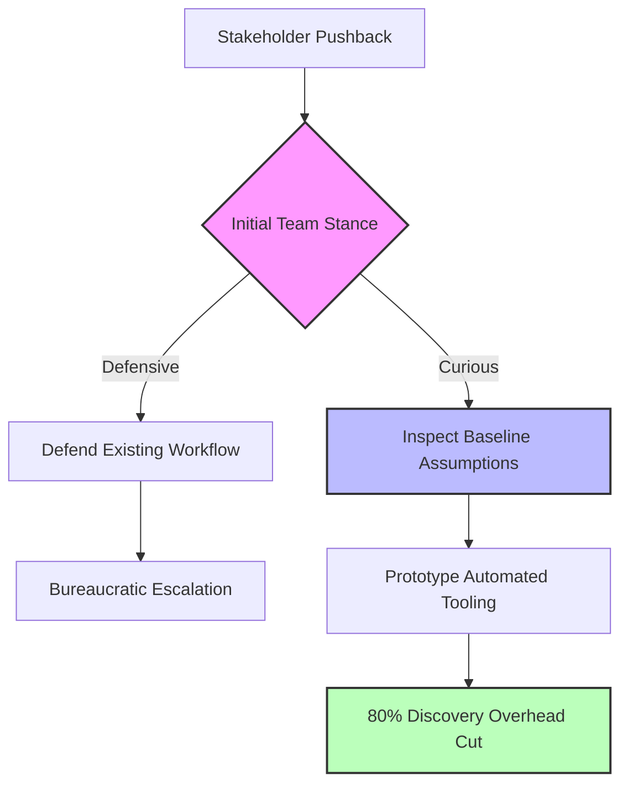

# Why Pushback is a Gift (And How to Use It)

> Takeaway: Stakeholder pushback exposes entrenched team assumptions and provides unexpected momentum to deliver automated customer solutions.

*Caption: Road detours reflect how pushback redirects engineering teams toward superior routes.*

Stakeholder resistance on an engineering proposal feels like an immediate roadblock. It halts momentum and sparks defensiveness, yet unexpected friction often uncovers our highest leverage technical solutions.

Last quarter, our team sought sign-off on a 300-ticket campaign to migrate legacy data schemas across multiple internal services. During the architectural review, leadership issued an uncompromising requirement: build automated tooling so downstream engineering consumers do not audit tables by hand.

## The Muscle Memory Reaction

Our initial response was defensive resistance. Downstream consumers had manually validated these schema changes for four years without tooling assistance.

We compiled a list of edge cases explaining why heuristic automation would fail on variable customer schemas. Long-standing operational habits create stubborn **muscle memory**. Teams defend manual friction simply because existing workflows feel familiar.

Stakeholders rejected our objections and demonstrated a working keyword prototype. That forced us to stop debating and evaluate what tooling was genuinely feasible.

## The Automation Pivot

Stepping back from defensive habits unblocked immediate technical alternatives. Within forty-eight hours, we assembled a hybrid scanner using keyword filtering and automated verification agents.

The initial scanner was imperfect and produced occasional false positives. However, it eliminated 80% of manual discovery overhead for downstream teams and flagged orphaned tables that manual audits consistently missed.

| Response Mode | Immediate Action | Operational Focus | Long-Term Outcome |
| :--- | :--- | :--- | :--- |
| Defensive Reaction | List reasons automation fails | Protect familiar workflows | Escalation and stagnant processes |
| Curious Exploration | Question core assumptions | Prototype partial tooling | 80% overhead cut and asset discovery |

## The Detour Analogy

<!-- Analogy: driving -->
Daily commutes rely on unconscious habits. Drivers follow the identical highway route each morning without evaluating alternatives.

When road maintenance posts a detour sign, initial annoyance is universal. Drivers look for shortcuts before accepting the mandatory diversion.

Taking the detour frequently reveals a secondary route with fewer traffic signals and shorter transit times. Pushback acts as that highway detour sign by forcing teams off stagnant operational paths.

## What to do next

Pause defensive escalations when stakeholders reject your project proposal. Audit your baseline operational assumptions against the specific failure modes highlighted by the reviewer. Build a rough prototype within forty-eight hours to test whether partial automation resolves the blocker.
