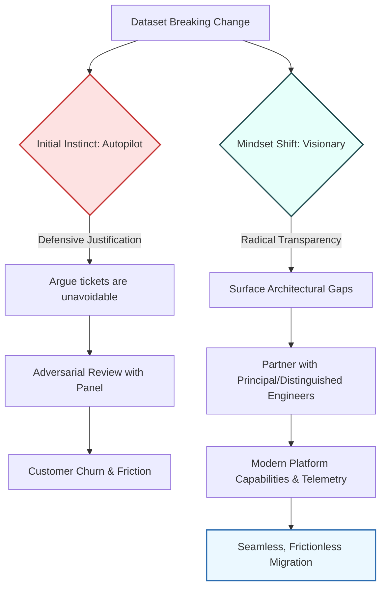

# A Couple of Conversations Away: Turning Pushback into Company-Wide Leverage

> Takeaway: Transform architecture review friction into platform leverage by replacing ticket campaigns with automated multi-version dataset contracts.

*Caption: Physical bridge models demonstrate how alignment creates architectural leverage.*

When rolling out breaking changes to a core dataset, most software organizations run a predictable playbook. They file Jira tickets across dozens of downstream teams, track migration burn-down charts, and wait months to deprecate old schemas.

My team recently prepared to launch a massive ticket campaign. Before sending the batch, our proposal went before an engineering review panel of Senior Principal and Distinguished Engineers.

Their mandate was direct: protect downstream teams from **unnecessary churn** and stop using tickets as a substitute for design.

When the panel rejected our plan, our immediate reaction was defensive. Our legacy pipelines lacked versioning. Rebuilding the ingestion layer felt prohibitive. From our vantage point, mass tickets seemed like the only practical option.

A podcast interview quickly shifted my perspective on the whole standoff.

## The Catalyst: Resources Are a Conversation Away

Shortly after that review, I listened to entrepreneur Daniel Priestley on *The Diary of a CEO*. During the discussion, Priestley outlined how leaders secure resources:

> "The visionary has a different view of life. And the first thing is that if a resource exists on the planet anywhere, that resource is just a couple of conversations away... Someone woke up this morning with the resource that you want. And if you have a conversation about how that resource gets used, essentially, it's as good as you having the resource."
-- Daniel Priestley

Priestley highlighted the production of the original movie *Top Gun*. The film crew initially planned to construct detailed, expensive miniature scale models of aircraft carriers and fighter jets. Then a producer asked: *“Have we called the Navy?”*

The filmmakers reached out and discovered that the Navy faced aggressive recruitment targets. By aligning incentives, the Navy supplied real fighter jets and aircraft carriers for filming at minimal cost.

Priestley contrasted three distinct operating mindsets:

1. **Reptile Mode:** Reactive, defensive, and combative toward reviewers who offer critical feedback.
2. **Autopilot Mode:** Resigned to legacy friction (*"This is how we have always operated"*).
3. **Visionary Mode:** Stepping back to ask: *"Who already controls the capabilities needed to solve this properly?"*

During that review session, I was trapped in Autopilot. I defended past architectural debt instead of seizing the opportunity directly in front of us.

## The Transit Detour vs. The Parallel Tunnel

<!-- Analogy: civil infrastructure -->
Consider municipal utility maintenance in a dense metro area. A water department needs to replace an aging water main beneath a primary boulevard. The fast route is dropping barricades across residential driveways and ordering neighbors to detour through side streets for a month.

When the transit board denies the permit to avoid gridlock, the utility crew reacts with outrage: *"The pipe is leaking! What else can we do?"*

An observant crew looks across the median. The transit authority is already digging a parallel utility tunnel two blocks away. By starting a conversation with transit planners, the water crew routes the pipe through the existing tunnel without disrupting neighborhood traffic.

Platform resources already exist across your company. Review panels are not roadblocks; they hold the blueprints to existing platform conduits.

## Rethinking the Architecture: Beyond the Ticket

Instead of asking how to justify another ticket barrage, we asked a harder question: how do we **eliminate ticketing** permanently?

Removing the assumption that consumers must manually rewrite queries on our timeline revealed three platform capabilities:

1. **Multi-Version Dataset Coexistence:** Maintain dual schema views concurrently so downstream consumers migrate on their standard sprint cycles rather than under forced cutover deadlines.
2. **Automated Telemetry-Based Tracking:** Observe query logs, access tokens, and pipeline lineage directly to track consumer cutover without relying on manual status checks.
3. **Continuous, Library-Style Rollouts:** Distribute shared dataset clients and contracts like software libraries, using canary rollouts and automated testing instead of spreadsheet tracking.

*Caption: Versioned schema contracts allow consumers to migrate at their own release cadence.*

## The Radical Transparency Proposal: A Four-Way Win

Building these primitives takes engineering time, but the architecture panel was the ideal forum to secure funding. Principal Engineers operate across organizational boundaries. They want to eliminate systemic operational drag across dozens of data pipelines, not arbitrate individual ticket batches.

We presented our architectural gaps openly with estimated engineering investments. That **radical transparency** converted a contentious gate into a funded platform initiative.

| Stakeholder | What They Gain |
| :--- | :--- |
| **Individual Contributor** | Staff-level scope across data engineering platforms and measurable technical leadership. |
| **Engineering Manager** | Cross-organizational influence and high-leverage delivery for the team. |
| **Principal / Distinguished Engineers** | Fulfilling their core mandate: removing developer toil across the organization. |
| **Downstream Customer Teams** | Zero ticket clutter, zero forced migrations, and stable, versioned data contracts. |

## What to do next

Present architectural gaps openly to senior review panels instead of defending ticket campaigns. Build telemetry-driven multi-version schemas that decouple platform changes from downstream team schedules. Align migration incentives across stakeholders to turn review friction into company-wide platform leverage.
