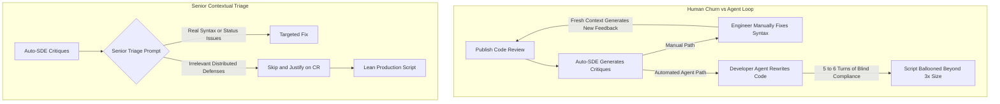

# Breaking the Agent-on-Agent Review Loop

> Takeaway: Automated review bots enforce excessive hardening on simple internal scripts, requiring senior engineer prompts to filter feedback and protect developer velocity.


*Caption: Automated reviewers enforce excessive hardening on internal shell scripts without human context.*

Automated review bots and developer agents easily trap engineering teams in **runaway hardening loops**. During an on-call shift last week, I watched two Large Language Model (LLM) agents turn a straightforward shell utility into an over-engineered fortress. The process revealed how delegating reviews to unguided bots creates hidden architectural drag.

I used an LLM agent to write a **compact shell script** that posted ticket updates as our on-call automation handled active alarms. The script needed to perform three basic actions: parse an issue identifier, format an operational timestamp, and call an internal ticket endpoint using `curl`. The initial implementation was concise and straightforward.

## The Shifting Target of Automated Code Reviews

Whenever I published a Code Review (CR), our Automated Software Development Engineer (Auto-SDE) reviewer bot triggered automatically and generated inline critiques. Originally, I reviewed each comment manually, decided what to fix, and pushed an updated revision. Because each push presented a fresh diff to the bot, it generated entirely new variations of feedback on the updated syntax. Chasing those shifting comments became an **exhausting manual loop**.

I asked team members how they survived this endless review cycle. Several peers explained that you can connect your local developer agent directly to Auto-SDE, allowing both tools to loop automatically until zero unresolved comments remain. Offloading the review chore sounded like an immediate win. I enabled the loop and let the agents resolve the review.

## Why Review Bots Over-Harden Shell Scripts

Automated review bots lack operational context about **deployment blast radiuses**. They apply tier-1 distributed service standards to every change regardless of runtime reality. When an automated reviewer inspects a shell utility, it demands defensive patterns designed for public multitenant APIs.

<!-- Analogy: automotive -->
Demanding heavy armor plating and run-flat tires for a maintenance golf cart used inside a private warehouse adds massive weight for no benefit. The vehicle carries light tools between shelving aisles at eight miles per hour. It does not navigate highway ambush zones.

The automated handoff created a worse problem than the manual fatigue it replaced. It took more than five to six turns between the developer agent and Auto-SDE to satisfy every comment. Across those turns, the process ballooned the shell script to **more than three times its size**, adding long comments and complex conditionals as part of defensive programming.



## The Senior Engineer Prompt Filter

Watching two agents spend six turns over-hardening a single utility proved that automated looping is flawed without boundaries. Developer agents default to total compliance because they treat reviewer comments as mandatory blockers. To halt the churn, I began prompting developer agents with an explicit **senior operational filter**.

```markdown
You are a senior engineer reviewing feedback for an internal operational shell script.
Operational Context:
- Target: On-call shell script posting ticket updates during alarm triage.
- Blast radius: Single workstation shell session, authenticated engineer session.
- Concurrency: Single operator process, sequential ticket updates.

Instructions:
1. Accept and fix real shell syntax errors, parameter quote bugs, or bad HTTP status handling.
2. Reject suggestions that add distributed file locking, complex signal trap trees, or speculative multi-tenant guards.
3. For each rejected suggestion, write a 1-sentence technical justification to post on the CR.
```

When re-evaluating the feedback with this prompt, the developer agent completed review triage in a single pass. It accepted one legitimate fix: quoting a ticket identifier variable to prevent word splitting during `curl` execution. It rejected comments demanding race-condition traps, complex conditional branches, and verbose explanatory blocks. I posted the **generated justifications** on the review and closed the threads.

## Matching Hardening Standards to Operational Scope

Engineering teams must calibrate code hardening to operational risk. Defenses that protect internet-facing payment services only add friction to local shell utilities. Senior engineers preserve delivery velocity by enforcing **proportional rigor** across system tiers.

| Review Criterion | Public Production Service | Internal On-Call Shell Script |
| :--- | :--- | :--- |
| **Execution Context** | High-throughput distributed fleet | Local shell process run by on-call agent |
| **Input Origin** | Untrusted external clients | Structured internal operational alarms |
| **Concurrency Protections** | Distributed locks and atomic database transactions | Sequential execution in one subshell |
| **Failure Mode** | Multi-zone failover and circuit breakers | Terminal exit code with readable error print |
| **Review Strategy** | Strict defensive compliance | Operational triage and minimal script complexity |


*Caption: Clear architectural boundaries prevent automated reviewers from over-hardening internal shell scripts.*

Pruning the defensive bloat allowed our script to ship as a **lean, readable utility**. Since launching the script and using it for a week, it has updated trouble tickets multiple times without any execution failure. When you prevent automated agents from over-hardening internal tools, your team gets to focus on real operational incidents.

## What to do next

Prompt your developer agents with explicit operational context before asking them to address review comments. Reject automated hardening suggestions that enforce distributed-system patterns onto internal shell utilities. Post concise technical justifications on code reviews to resolve bot comments and maintain codebase velocity.
