# Breaking the AI-to-AI Code Review Echo Chamber: Visual Topology vs. Risk-Weighted Inspection

> Takeaway: Pairing AI visual topology mapping with targeted manual inspection of high-risk surfaces prevents the silent outages caused by automated review echo chambers.

*Caption: Manual inspection of high-risk surfaces prevents production outages that automated summaries miss.*

As developer tools adopt generative AI, pull requests are ballooning in size. Engineers use coding assistants to generate hundreds of lines of infrastructure boilerplate, Cloud Development Kit (CDK) constructs, and data transformations in seconds. To cope with the massive diffs, reviewers paste the code back into an AI tool and ask for a summary. The result is a dangerous feedback loop: AI writes the code, AI summarizes the code, and nobody reads the diff.

During team reviews this week, I experienced the allure and danger of this workflow firsthand. I built a custom review skill that parses incoming diffs, maps infrastructure dependencies, and generates visual Mermaid diagrams showing data flows. The topology maps were brilliant for orientation. Yet our team quickly noticed a blind spot: high-level diagrams explain author intent, but they completely conceal runtime bugs.

## Why high-level architectural summaries conceal defects

<!-- Analogy: maritime -->
Think of maritime safety inspections. A port surveyor examines a vessel's general arrangement plan to understand bulkheads, cargo holds, and emergency corridors. That high-level layout confirms design intent, but it will never expose a fractured hull weld or a clogged bilge pump valve. To prevent a sinking, the surveyor must climb into the double bottom and inspect the steel plates directly.

Automated code review summaries present the exact same failure mode. An LLM summary tells you that a pull request establishes a streaming pipeline between a queue and a warehouse table. It will not warn you that a database column was dropped, an API pagination loop was truncated, or a security role was granted wildcard permissions. High-level summaries validate architecture while masking catastrophic line-level bugs.

## Comparing Automated Summaries with Risk-Weighted Inspection

| Review Dimension | Automated AI Summary | Risk-Weighted Manual Inspection |
| :--- | :--- | :--- |
| **Primary Scope** | System intent and architectural orientation | Defect identification and operational safety |
| **Inspection Target** | High-level data flows and components | Specific lines with high outage probability |
| **Review Velocity** | Two minutes to read visual diagram | Five minutes focused on critical surfaces |
| **Silent Blindspots** | Hollow test mocks and wildcard permissions | Author design intent across multiple files |
| **Team Responsibility** | Machine explains what the code plans to do | Human verifies where the code can fail |

## The Two-Phase Review Standard

To break the echo chamber without returning to manual review fatigue, I established a two-phase review standard for our team. The workflow balances machine orientation with human verification:

```mermaid
graph TD
    subgraph The AI-to-AI Echo Chamber
        A[Developer Uses AI to Generate 500-Line PR] --> B[Reviewer Uses AI to Summarize Diff]
        B --> C[AI Explains High-Level Author Intent]
        C --> D[Reviewer Approves Without Line Inspection]
        D --> E[Silent Outage in Production]
    end

    subgraph The Two-Phase Review Hybrid
        F[500-Line Code Diff] --> G[Phase 1: Automated Visual Topology]
        G --> H[2-Minute Orientation on Components & Data Flows]
        H --> I[Phase 2: Risk-Weighted Manual Inspection]
        I --> J[Check IAM Wildcards, Schema Migrations & Test Asserts]
        J --> K[Safe Production Deployment]
    end
```

- **Phase 1: Automated structural orientation:** When opening a diff, run an AI tool to generate a visual topology diagram of modified resources and data pipelines. Use this map strictly to understand what the author is trying to achieve within two minutes.
- **Phase 2: Risk-weighted manual inspection:** Once oriented, ignore general boilerplate and manually inspect the specific lines that cause production outages. Never click approve until human eyes have verified critical operational boundaries.

## The Four Surfaces That Demand Human Eyes

Instead of reading every line of generated syntax, senior engineers focus their attention on four high-risk surfaces:

- **Identity and Access Management (IAM) policies:** Automated code generators frequently add wildcard actions or resource asterisks to make permissions pass on the first run. Always verify that roles adhere to least privilege.
- **Data schemas and column mutations:** Large Language Models frequently drop schema columns or introduce type mismatches during database migrations. Manually confirm that new tables preserve backward compatibility.
- **Retry loops and throttling policies:** AI boilerplate rarely accounts for downstream API rate limits. Inspect backoff timers, circuit breakers, and batch chunk sizes to prevent cascading service failures.
- **Integration test assertions:** Generated tests often test trivial mocks rather than production invariants. Confirm that assertions actually evaluate error status codes, dead-letter queues, and boundary conditions.

*Caption: The two-phase review standard balances automated architectural mapping with manual line checks.*

## Restoring Engineering Accountability

Tools advise, but engineers decide. Using AI to orient yourself on a 600-line pull request is smart engineering. Using AI as an excuse to avoid inspecting code is negligence.

When you enforce a strict boundary between automated structural mapping and manual risk inspection, review speed increases without sacrificing reliability. You catch the architectural intent in two minutes, verify the high-risk lines in five minutes, and keep your production systems protected.

## What to do next

1. Stop using AI summaries as a replacement for reading pull request diffs.
2. Use automated tools exclusively for high-level topology mapping and architectural orientation.
3. Inspect IAM policies, schema mutations, retry logic, and test assertions before approving any change.
