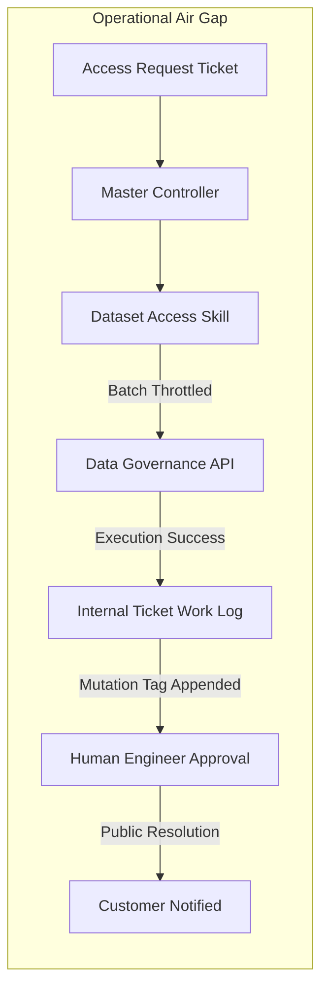

# Finishing Over Starting: Why 168 Production Tickets Beat an Unfinished Autonomous Agent

> Takeaway: Bounding an AI agent to internal staging logs and automated mutation telemetry converts stalled prototypes into finished tools that deliver real production velocity.

*Caption: Production automation relies on clear operational telemetry and bounded staging logs.*

Every engineering team experimenting with operational AI agents eventually attempts the grand architecture. You design an end-to-end assistant that monitors alert queues, reads runbooks, parses log streams, and resolves customer tickets autonomously. The ambition looks impressive on design diagrams, but it quickly stalls in execution. The model stumbles over authentication permutations, noisy Application Programming Interface (API) payloads, and ambiguous edge cases.

During an active on-call shift this week, I hit this exact wall. My goal was an ambitious copilot to eliminate ticket fatigue. Instead of delivering velocity, the sprawling design left me stuck reviewing incomplete prototypes while real access requests piled up in our team backlog.

## The Commute Revelation: Just-in-Time Scaffolding

During my morning commute, I listened to an interview with Kevin Hart on *The Diary of a CEO*. His message was simple: starting things is easy, but finishing is all that matters. The world is full of ambitious prototypes that never clear real production hurdles.

I recognized my own intellectual evasion trap. In the past, I transcribed podcast quotes into note apps, hoarding advice that created an illusion of learning. Those passive notes produced zero long-term retention.

This time, I refused to take notes. I treated the interview as real-time emotional scaffolding for that afternoon's engineering tasks. I stopped chasing an expansive autonomous assistant and committed to shipping one bounded capability.

| Operating Attribute | Ambitious Autonomous Prototype | Bounded Production Agent |
| :--- | :--- | :--- |
| **Operational Scope** | End-to-end alert triage and resolution | Single bounded workflow execution |
| **Execution State** | 50% finished speculative framework | 100% completed micro-unit |
| **Mutation Target** | Direct customer communications | Internal ticket work logs (air gap) |
| **Verification Gate** | Post-incident customer escalation | Human-in-the-loop review of work logs |
| **Telemetry Method** | Unverified manual estimates | Automated metadata mutation tagging |
| **Production Metric** | Stalled on authentication edge cases | 168 resolved tickets per hour |

## Why production agents require a public air gap

<!-- Analogy: culinary -->
Think of a commercial restaurant kitchen. Line cooks prepare and plate dishes at their stations, but they never run food out to dining room tables. Every plate stops at the pass under the heat lamp, where the head chef inspects order accuracy before handing it to the waitstaff. The pass acts as an isolated staging boundary, ensuring kitchen errors are caught before a customer ever sees them.

Enterprise AI agents require the exact same boundary. Giving a Large Language Model (LLM) direct mutation access to customer-facing tickets or public status pages creates immense operational risk. When a model hallucinates context or misinterprets an issue, the mistake directly impacts clients. A reliable production agent must operate behind a strict public air gap.

## The Architecture: Work Logs as a Staging Layer

To turn this principle into working code, I scoped my on-call tooling down to a single repetitive bottleneck: dataset access requests. I connected our existing access management skill to the agent and introduced three operational invariants:

- **Internal work logs as a staging layer:** The agent never posts public customer messages or closes tickets. It evaluates access parameters, executes the permission change, and drafts its technical summary directly into the internal ticket work log. The on-call engineer reviews the draft, confirms accuracy, and sends the final response with a single click.
- **Automated mutation tagging:** Every time the LLM modifies a ticket work log, it appends an automated metadata tag to the record. This creates direct telemetry tracking how many on-call tickets and operational tasks are resolved through agents: a primary metric our organization measures to track automation adoption.
- **Throttled batch processing:** Production APIs quickly choke on unthrottled agent loops. Tuning the skill to execute in explicit batches of ten requests protected our data governance endpoints from rate limits and connection drops.

*Caption: Treating internal ticket work logs as a staging layer isolates agent execution from public risk.*

## The 168-ticket milestone

The results proved that finished micro-tools beat expansive prototypes. Running the batched access skill cleared 168 production access requests in a single hour. The internal work log staging layer prevented a single customer-facing defect, while automated mutation tags gave our team verifiable telemetry for our weekly on-call retrospective.

Finishing that single capability also proved the commute lesson. Passive note-taking creates mental clutter because thoughts never collide with reality. Taking a single insight, applying it to production code, and pushing it across the finish line builds durable muscle memory that lasts.

## What to do next

1. Audit your current AI agent experiments and identify one repetitive task that can reach 100% completion today.
2. Direct all LLM write actions to internal work logs or staging partitions rather than customer-facing channels.
3. Append automated attribution tags to every database or ticket mutation to collect verifiable operational telemetry.
