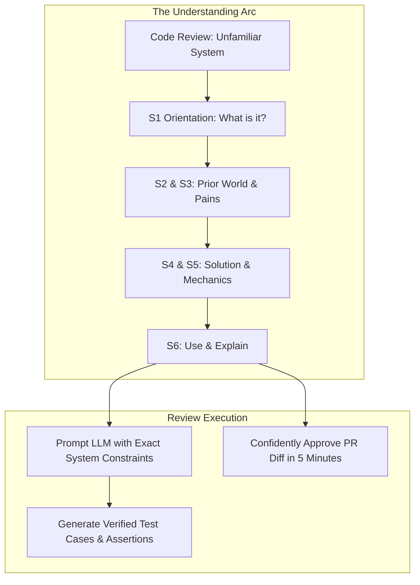

# Understanding Systems, Not Syntax: Managing Cognitive Load in the Age of Frontier Models

> Takeaway: Grounding frontier models in a progressive understanding arc before generating code eliminates cognitive exhaustion and restores senior architectural review leverage.

*Caption: Senior engineering leverage comes from defining system mental models before generating code.*

Frontier models excel at outputting syntax. Ask a Large Language Model (LLM) to configure an unfamiliar cloud platform, and it immediately outputs fifty lines of configuration, five obscure parameters, and a dozen speculative error flags. The code looks complete, but evaluating every option drains your mental energy. Instead of moving fast, you end up trapped in analysis paralysis.

During a team code review this week, I hit this exact wall. A peer submitted a Pull Request (PR) introducing an internal infrastructure platform our data team had not touched before. When I asked an LLM to explain the setup and suggest review checks, it buried me in a blizzard of Cloud Development Kit (CDK) constructs and edge cases. I lacked the baseline context to separate real system invariants from hallucinated noise. Attempting to out-memorize the syntax left me exhausted.

## Why open-ended model prompts cause analysis paralysis

<!-- Analogy: automotive -->
Think of automotive mechanics. A master technician diagnoses transmission failure by understanding torque converters, hydraulic fluid pressures, and planetary gear ratios. The technician never wastes mental capacity memorizing the exact thread pitch or part numbers of every bolt on the chassis. Part numbers live in manufacturer catalogs. If you try to repair a car by memorizing parts lists instead of understanding mechanical cycles, you assemble a stalled engine.

Software engineers make this exact mistake with frontier models during code reviews. When you ask an LLM an open-ended question like *what do you recommend?*, the model generates unranked possibilities. It treats internal batch jobs and customer-facing payment services as if they carry identical operational risks. Because you gave it no architectural constraints, the model dumps theoretical configurations that overwhelm your working memory.

## Comparing Open-Ended Model Churn with Progressive System Research

| Engineering Dimension | Open-Ended Model Churn | Progressive System Research |
| :--- | :--- | :--- |
| **Initial Prompt** | *"What do you recommend?"* | Structured S1 to S6 understanding arc |
| **Starting Focus** | Syntax flags and configuration keys | Prior world and operational pains (S2 and S3) |
| **Context Separation** | Blurs team quirks with tool mechanics | Explicit Core Architecture vs Org tracks |
| **Cognitive Outcome** | Analysis paralysis and review fatigue | Fluent mental model and rapid PR review |
| **Review Execution** | Guessing at boilerplate lines | Verifying lifecycles and blast radiuses |

## The Flaw: Jumping to Mechanics Before Problems

The common error when learning a system is jumping straight to **how it works** before understanding **why it exists**. 

You cannot judge a technical solution until you know the concrete problem that forced its creation. You cannot explain an architecture to peers until you understand the prior world it replaced. When an LLM explains an unfamiliar system, reading its configuration parameters without knowing its historical pain points produces hollow comprehension.

To fix this, I built a dedicated deep-research skill that navigates six progressive stations in strict sequence:

- **S1 Orientation:** What is the system in one breath, where does it sit in the topology, and who owns it?
- **S2 Before:** What existed before this system: the shape of the prior world?
- **S3 Problems:** What concrete operational pains broke that prior world and forced a change?
- **S4 Solution:** How was the current architecture conceived to eliminate those specific pains?
- **S5 Mechanics:** How does data flow through the components at runtime, and where do transactions commit or fail?
- **S6 Use & Explain:** What is the minimal command to prove it works, and what is the 60-second pitch to explain it out loud?

Researching S2 and S3 before touching S4 and S5 changes everything. Once you understand the broken state that forced the tool into existence, the runtime architecture in S5 makes immediate sense.

## Separating Core Architecture from Organizational Reality

Another hidden source of cognitive drain is conflating **what a technology is** with **how your company uses it**. 

When researching a new tool, documentation often mixes universal system mechanics with team-specific migration tickets, temporary credentials, and local policy holds. This contaminates your mental model with transient noise.

To prevent this confusion, our research skill enforces two distinct knowledge tracks:

1. **The Core Track:** Universal system architecture that remains true for any engineer across the industry (S1 through S6).
2. **The Org Track:** Internal company adoption, including our specific problem scope, onboarded pipelines, and active security approvals.

Keeping local operational context isolated in a dedicated org track protects the core mental model. You master the clean architectural invariants first, then evaluate your team's local constraints second.

*Caption: Progressive research ledgers extract system mental models before delegating syntax generation to models.*

## The Division of Engineering Labor

Frontier models have turned syntax into a disposable commodity. High-value engineering no longer lives in remembering configuration properties or CLI flags. Senior leverage comes from defining operational invariants, system boundaries, and failure isolation.

Let the model generate the JSON templates, CDK definitions, and boilerplate scripts. Your responsibility is understanding where data lives, how failure propagates, and which external dependencies must be isolated. When you stop competing with models on syntactic recall, mental fatigue disappears.

## What to do next

1. Stop asking frontier models open-ended recommendation prompts when reviewing unfamiliar tools or frameworks.
2. Research the prior world and operational pains before inspecting how a new system operates.
3. Separate core system architecture from internal company adoption to keep your mental model clean.
