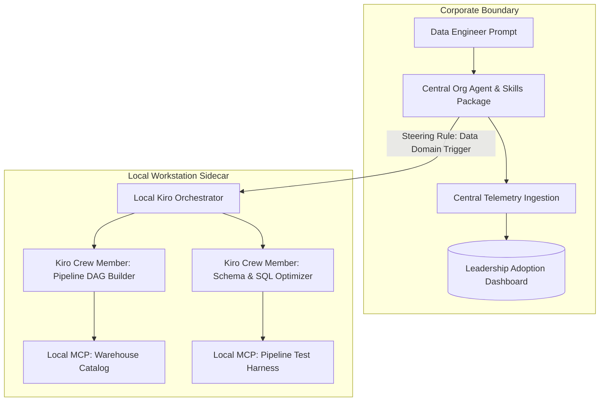

# The Enterprise AI Sidecar: Routing Central Agents to Local Data Crews

> Takeaway: Steering central software-focused agents to delegate data engineering tasks to local crew members preserves leadership telemetry while unlocking specialized domain capabilities.


*Caption: Local crew members handle specialized execution while centralized routing preserves leadership telemetry.*

Engineering leadership teams are investing heavily in organization-wide AI skill packages and agent catalogs. Directors track **adoption telemetry**, measuring active sessions, command invocations, and seat utilization across departments. Yet most centralized agent catalogs are designed exclusively for general software engineering. They excel at writing web services, generating unit tests for application servers, and scaffolding cloud infrastructure.

As a data engineer, that software bias creates immediate operational friction. Data engineering workflows operate on entirely different primitives: warehouse schemas, partition pruning, storage formats, pipeline Directed Acyclic Graphs (DAGs), and dialect-specific SQL transformations. When I attempt to use the corporate agent package to refactor a complex data pipeline, it stumbles over missing domain context. Bypassing the central tool entirely solves the local problem, but it tanks **organizational adoption metrics** on leadership dashboards.

## Why centralized agent catalogs miss domain workflows

<!-- Analogy: medicine -->
A hospital emergency triage desk evaluates incoming patients, logs vital statistics, and updates institutional intake records. Triage nurses categorize symptoms and assign priority bands, but they do not perform orthopedic surgery or interpret cardiac catheterization imagery. Specialized surgeons and cardiologists in dedicated treatment suites execute those targeted procedures using **specialized clinical instruments**.

Centralized engineering agents occupy that exact **triage position**. An organization-wide agent catalog standardizes authentication, enforces safety guardrails, and records telemetry for engineering directors. It lacks the domain primitives required to manage data pipelines, such as verifying partition keys, diagnosing shuffle spill, or compiling SQL dialect variations. To execute data engineering tasks effectively, developer agents require direct access to Model Context Protocol (MCP) servers running inside local workspaces.

## The Local Sidecar Architecture

Instead of abandoning the standard corporate toolchain, we can deploy an **adapter pattern**. We keep the central organization agent as our front-door interface, while authoring steering rules that route domain tasks to local Kiro crew members.



The central agent serves as an intelligent **front-door router**. It captures the initial developer prompt, registers usage telemetry in central platform analytics, and delegates domain execution to local crew members. The local Kiro crew members inspect repository schemas, query local warehouse catalogs through MCP servers, and return production-ready transformations.

## Comparing Central Org Skills with Local Domain Crews

| Operating Dimension | Central Organization Agent Package | Local Kiro Data Crew Sidecar |
| :--- | :--- | :--- |
| **Primary Focus** | General software engineering and services | Warehouse pipelines and data transformations |
| **Domain Primitives** | API endpoints, microservices, and web boilerplate | Partition keys, column schemas, and DAG steps |
| **Tool Extensibility** | Approved enterprise plugins and cloud APIs | Local MCP servers for warehouse catalogs and engines |
| **Telemetry Impact** | Directly feeds executive adoption dashboards | Invisible to central enterprise dashboards |
| **Failure Triage** | Handled through centralized support tickets | Iterated and refined locally inside the active workspace |

## Implementing Prompt Steering as a Lean Adapter

Building custom network daemons or inter-process bridges between developer environments and central enterprise agents introduces unnecessary complexity. A much cleaner baseline is **prompt steering directives** embedded into the agent configuration.

We configure the central agent with explicit domain steering directives. When the agent detects requests involving data warehouse schemas, pipeline orchestration, or SQL performance tuning, it outputs a delegation packet targeted at local Kiro crew members:

```yaml
# Central Agent Steering Directive
system_instruction:
  domain_delegation:
    trigger_conditions:
      - data_pipeline_mutation
      - warehouse_schema_migration
      - sql_partitioning_audit
    action: "Route structured task packet to local Kiro data crew executor"
```


*Caption: Combining cloud telemetry logging with local terminal execution keeps enterprise metrics intact.*

This configuration preserves **operational harmony** across engineering tiers. Leadership dashboards record steady agent adoption and command volume from the data team. Meanwhile, the data engineer gains access to specialized Kiro crew members that understand partition pruning, schema migrations, and warehouse execution plans.

## What to do next

1. Route all initial developer tasks through the central organization agent to record leadership adoption telemetry.
2. Build local Kiro crew members tailored to your domain-specific primitives and local MCP servers.
3. Define prompt steering rules that detect domain tasks and delegate them without breaking executive tracking metrics.
