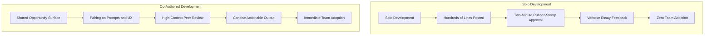

# The Illusion of Solo Velocity: Why Building Agent Skills in Isolation Fails

> Takeaway: Co-authoring internal AI tools trades solo perfection for shared context, high team adoption, and active mentorship across distributed engineering teams.

*Caption: Co-authoring internal tools drives team adoption far faster than isolated development.*

Large Language Models (LLMs) make code generation fast enough that engineers build complex internal capabilities entirely alone. When building speeds up, team communication slows down. In distributed teams with few organic syncs, **isolated development** fragments architectures and produces tools that nobody uses.

## The Fifty-Commit Ghost Utility

A teammate spent weeks building an internal evaluator skill for our AI agents. The project reached dozens of commits and hundreds of lines of code. The author posted pull requests along the way, but approvals arrived within minutes. Because an internal utility lacks customer blast radius, reviewers hit approve without questioning the prompts.

When the evaluator ran against my branch, it generated long essays of feedback. Real **actionable findings** sat buried under paragraphs of generic text. Three of the four critiques applied patterns that misunderstood my implementation. Only one comment delivered actual value.

## Why Building Internal Tools Alone Backfires

<!-- Analogy: civil engineering -->
Building a suspension bridge across a canyon without surveying local roads creates an impressive structure that connects to nowhere. Commuters continue using dirt detours because the ramps miss the actual traffic grid.

Internal tools create a dangerous loop of **superficial review hygiene**. An engineer shares a five-hundred-line PR, but teammates lack the mental model to critique it. Because the code is internal, peers skim the surface and approve it in two minutes. The author assumes silence equals validation, while the team inherits unvetted logic.

## Comparing Internal Tool Development Models

| Development Model | Upfront Alignment | Review Quality | Output Usability | Team Adoption |
| :--- | :--- | :--- | :--- | :--- |
| **Solo Hacking** | Zero shared context | Two-minute approvals on huge PRs | Verbose essays with buried signal | Near zero |
| **Co-Authoring** | Co-designed prompts and UX | High-context peer reviews | Concise and tested feedback | Immediate team buy-in |

## Trading Local Perfection for Adoption

When you build a tool alone, you control every design detail. The result matches your personal taste, but the team has zero **psychological ownership**. An internal tool built to your exact specifications that sits idle creates zero impact.

Shifting to **co-authored internal tooling** changes that result. When you invite a teammate to co-design prompts and test cases, you compromise on minor preferences. In return, you gain immediate operational feedback, shared maintenance, and a peer who champions the tool.

*Caption: Pairing on agent prompts grounds feedback in real developer workflows.*

## Rebuilding Team Connection and Mentorship

Remote work and automated code generation isolate engineers from daily peer problem-solving. Junior engineers can prompt an LLM for code, but they do not observe how senior engineers evaluate trade-offs. Pairing on prompt design and output formats provides practical **apprenticeship during development**.

Co-authoring replaces passive isolation with active collaboration. Working through edge cases together exposes newer engineers to system constraints and production judgment. The team gains tighter social bonds, shared code ownership, and lower turnover risk.

## What to do next

Identify one internal agent skill or utility in your backlog to co-author with a peer. Post an open invitation in team chat to find a partner before writing the first prompt. Pair directly on test runs to verify that agent outputs remain concise and actionable.
