# The Invisible Floor: Why Tech Bubble Grievance Collapses Outside the Office

> Takeaway: Stepping outside corporate tech echo chambers reveals our complaints as elite friction while restoring gratitude for baseline stability.

*Caption: Real-world community interactions restore genuine gratitude by puncturing insular tech workplace bubbles.*

Software engineers operate inside some of the most comfortable bubbles in the modern economy. We work in temperature-controlled rooms, debate system architecture, and receive top-decile compensation. Yet spend ten minutes on anonymous corporate forums, and you will hear engineers talk as if sprint delays, shifting roadmaps, and code review comments are existential torture. When we isolate ourselves within industry circles, we **lose all sense of proportion**.

I have fallen into this trap myself. During heavy on-call rotations and project deadlines, **minor operational friction** feels exhausting. Last week, I caught myself brooding over backlog priorities and tooling limitations, as though those obstacles threatened my safety. It took a single Saturday outside our professional circle to shatter that self-absorbed narrative.

## Why corporate bubbles manufacture artificial stress

<!-- Analogy: aviation -->
Think of a pressurized passenger jet cruising at high altitude. Inside the cabin, climate systems regulate temperature, oxygen levels, and air pressure so travelers sit in total comfort. After a few hours, passengers begin grumbling about lukewarm coffee or slow seat recline. They forget that six inches beyond the aluminum fuselage lies a **subzero vacuum** that would freeze water in seconds.

Corporate technology environments produce the same **distorted baseline**. Because salary, health insurance, and legal stability are taken for granted, the human mind moves the friction boundary upward. Minor inconveniences like flaky unit tests or meeting fatigue get treated as crises. We know when our day feels bad, but we forget how secure the floor beneath us remains.

## Two Encounters That Reset My Perspective

On Saturday evening, my wife and I attended a **Durga Puja festival** at our local temple. The food distribution line stretched across the parking lot, taking over an hour to reach the front. While waiting, my wife struck up a conversation with a young Indian couple holding an eleven-month-old infant girl.

Their story silenced my internal complaints immediately. Their daughter had been born premature, requiring weeks in intensive care. Soon after, the father lost his job, leaving the mother to provide for their child while working under the restrictions of an active student visa. They **faced legal precarity**, joblessness, and infant health scares simultaneously, yet stood patiently in line with warm smiles and quiet dignity.

That temple encounter mirrored a father I met at our local public library. He works eleven-hour shifts every day, followed by an eight-hour shift on Fridays, while his wife works two separate shifts and returns home at eleven at night. He considered driving for a rideshare service after his shifts to earn extra income, but **sheer physical fatigue** stopped him. Despite that grinding routine, he still brings his daughter to the library daily and stretches his finances to take her to the mall and arcade on weekends.

*Caption: Stepping into community spaces grounds daily engineering challenges against real-world perseverance.*

## The Contrast Between Manufactured and Grounded Friction

| Dimension | The Tech Echo Chamber | Real-World Community Baseline |
| :--- | :--- | :--- |
| **Primary Anxiety** | Sprint delays and code review feedback | Infant healthcare and visa legality |
| **Daily Horizon** | Performance reviews and team prestige | Monthly rent and family survival |
| **Daily Workload** | Ergonomic chairs and flexible indoor hours | Eleven-hour shifts and two-shift night schedules |
| **Coping Mechanism** | Venting on anonymous corporate forums | Persistent family sacrifice and discipline |
| **Underlying Safety** | High compensation with deep savings buffers | Thin safety margins with direct personal risk |

Looking at that table reveals what I call the **luxury of chosen friction**. As engineers, we do not wrestle with basic survival. We wrestle with intellectual puzzles that we agreed to solve in exchange for substantial compensation. Treating a messy codebase or an ambiguous product specification as trauma is an insult to people fighting genuine battles every morning.

## Recalibrating Daily Engineering Inconveniences

This perspective shift immediately altered how I respond to daily office friction. When the filtered drinking water machine on our floor stopped working this week, I felt zero irritation. In the past, that defect might have triggered grumbling about corporate facilities. Instead, I took the elevator down one floor to fill my bottle, grateful for **zero emotional energy** wasted on non-problems.

I began noticing other unearned privileges across my daily routine. My company allows me to work remotely from California, even though my engineering team sits in Seattle. Our leadership also provides unlimited token budgets on Large Language Model (LLM) endpoints for development and research. These are extraordinary institutional privileges, not entitlements, yet insular tech culture trains engineers to **take them for granted**.

```mermaid
graph TD
    subgraph The Isolated Echo Chamber
        A[Workplace Inconvenience] --> B[Venting on Anonymous Forums]
        B --> C[Amplified Resentment]
        C --> D[Perception of Existential Misery]
    end
    subgraph The Grounded Reality Anchor
        E[Workplace Inconvenience] --> F[Community Exposure & Conversation]
        F --> G[Calibration Against Real-World Struggles]
        G --> H[Gratitude for Institutional Benefits]
        H --> I[Focus on Immediate Technical Execution]
    end
    style A fill:#fde2e2,stroke:#c53030,stroke-width:2px
    style D fill:#fed7d7,stroke:#9b2c2c,stroke-width:2px
    style E fill:#e6fffa,stroke:#234e52,stroke-width:2px
    style I fill:#ebf8ff,stroke:#2b6cb0,stroke-width:2px
```

## Replacing Grievance with Execution

Calibrating against real-world struggles changes our posture toward stalled projects. When cross-team dependencies stall or pipeline deployments fail, joining the complaint echo chamber produces zero progress. Grounded perspective allows us to bypass grievance, channel our energy into shipping working software, and appreciate the **freedom to build**. It reminds us that our hardest workday is often someone else's dream scenario.

## What to do next

1. Mute anonymous workplace grievance forums that distort your baseline perspective on professional problems.
2. Calibrate daily engineering friction against your institutional stability whenever sprint delays or broken office fixtures trigger irritation.
3. Spend time every week in community spaces like public libraries, temples, or parks to stay grounded in everyday reality.
