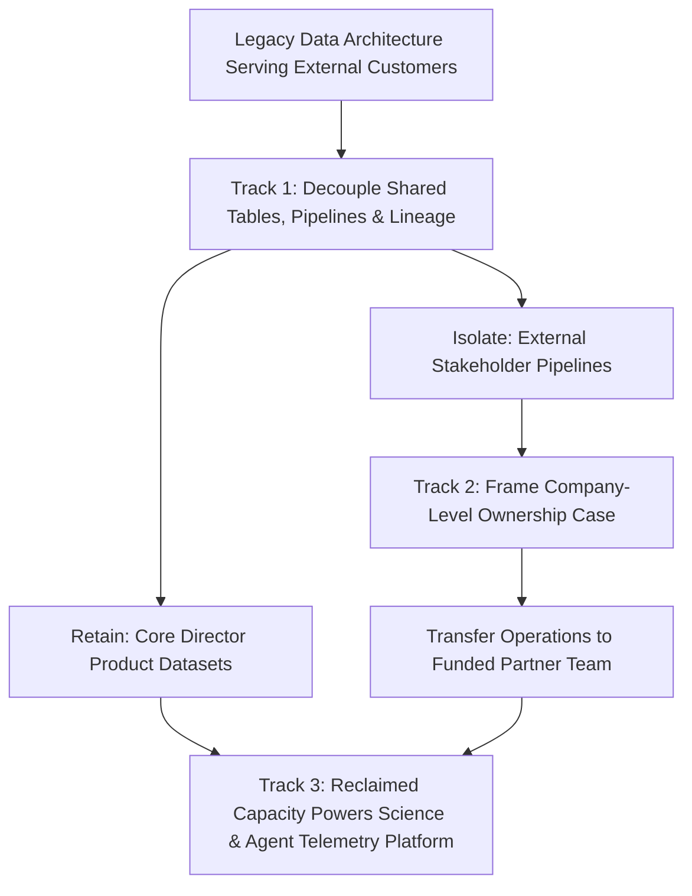

# The Pen-Holder Advantage: Finding Uncontested Leverage in Boring Scope Transitions

> Takeaway: Decoupling legacy codebase boundaries and driving cross-team ownership transfers delivers uncontested organizational leverage while peers crowd around shiny agent architectures.

*Caption: Drawing clear codebase boundaries creates uncontested organizational leverage before greenfield architecture begins.*

Greenfield architecture attracts nearly every engineer in an organization, especially when the brief involves AI agents and applied science. Designing a new platform on a clean whiteboard feels like high-visibility innovation. Yet crowded rooms dilute individual impact, while legacy debt consumes daily team capacity. The highest-leverage Staff engineering work sits in the uncrowded space other engineers avoid: decoupling legacy architectures and negotiating cross-team ownership transfers.

Our data engineering team inherited that exact structural puzzle. Years ago, we built a people analytics data architecture because we were strong at operating complex pipelines. Across several reorgs, our charter shifted, yet we kept running those datasets for a customer base outside our Director's primary products. We still owned the legacy system simply because we had been good at owning it.

## Why new platform architectures stall without legacy decoupling

<!-- Analogy: construction -->
A homeowner wants to convert a two-car garage into a woodworking studio. Everyone wants to shop for table saws, dust extractors, and lighting rigs. Yet half the garage remains stacked to the ceiling with heavy crates left behind by a relative after three moves. Until someone inventories those crates, separates shared tools, and persuades that relative to move their boxes out, no workbench fits inside.

Engineering teams hit the same **capacity gridlock** when they build new platforms on top of unpruned legacy commitments. In our alignment meeting, my manager outlined three tracks required to pivot our team toward our Director's core products:

1. **Decouple the legacy data architecture:** Audit our coupled repositories and pipelines to separate what serves our Director's core products from what serves external stakeholders.
2. **Drive the cross-team ownership transfer:** Build a company-level proposal that influences the funded partner team to accept operational ownership of those legacy assets.
3. **Re-architect for science and AI agents:** Design a modern platform to fix weak agent telemetry, close observability gaps, and enable experimentation for data-driven product decisions.

## Why engineers avoid cross-team ownership transfers

Two peers took on the third track: re-architecting our platform to support applied science and AI agent experimentation. Today, our products have poor telemetry and limited experimentation tooling to measure how agents perform in production. Solving that observability gap is **intellectually magnetic work**. Every engineer wants to design telemetry schemas for agents and build experimentation engines for science teams.

My manager proposed that I lead the first two tracks: untangling the legacy architecture and driving the cross-team ownership transfer. Most engineers treat legacy decoupling and ownership negotiations as **unappealing administrative chores**. I liked that space because nobody competes for it.

Those first two tracks are hard for reasons unrelated to syntax:

- **Ambiguous technical coupling:** Legacy architectures rarely respect org charts, because shared staging tables, scripts, and schedules weave external metrics into internal pipelines.
- **Zero-incentive handoffs:** No partner team volunteers to inherit legacy pipelines, on-call pages, and maintenance tickets without a clear business case.
- **Company-first persuasion:** Influencing another team to accept ownership requires proving why the transfer makes sense for the company, not merely offloading toil.

## Claiming the pen-holder advantage in uncrowded space

Taking ownership of the ambiguous, unglamorous tracks gives you the **pen-holder advantage**. While others debate future architecture diagrams, the engineer who audits the legacy system and drafts the transition plan defines the operational reality for both teams.

| Priority Track | Core Engineering Problem | Primary Friction | Organizational Leverage |
| :--- | :--- | :--- | :--- |
| **1. Legacy Architecture Decoupling** | Untangling shared schemas, lineage, and jobs | High ambiguity across years of organic growth | Establishes the exact boundary of team ownership |
| **2. Cross-Team Ownership Transfer** | Framing an enterprise-wide handoff proposal | Partner teams resist taking on legacy maintenance | Permanently exits uncredited service-bureau work |
| **3. Science & Agent Re-Architecture** | Building agent telemetry and experimentation | Crowded design space blocked by legacy toil | Unlocks data-driven product decisions once funded |

*Caption: Auditing dataset boundaries first establishes the operating taxonomy for cross-team transitions.*

Operating in this less crowded space delivers three outcomes:

1. **You define the boundary taxonomy:** Auditing the codebase first lets you decide which tables stay with your Director's org and which pipelines transfer out.
2. **You practice executive persuasion:** Crafting a transfer proposal forces you to reason from company-level economics, charter alignment, and reduced duplication.
3. **You unlock the shiny architecture:** Neither science experimentation nor agent telemetry can thrive if the team remains buried under legacy tickets from past reorgs.

Shiny architecture projects always draw a crowd. Choosing the ambiguous decoupling and influence work lets you reshape how the organization runs, with zero competition for the pen.

## What to do next

1. Audit your legacy data architecture to map which pipelines serve your leadership's core products versus external customers from past reorgs.
2. Frame cross-team ownership transfers around company-level charter alignment and eliminated duplication rather than local bandwidth relief.
3. Volunteer for the uncrowded decoupling and handoff tracks so you hold the pen on your organization's operating boundaries.
