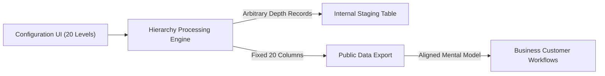

# Why Brownfield Codebases Still Need Human Review

> Takeaway: Clean code generation handles local syntax, but human engineers must protect the scattered context that AI models cannot see.

*Caption: Handwritten notes capture scattered system rules during human review sessions.*

Last week, I sat down to review a team Pull Request (PR) that looked completely spotless. A peer used a Large Language Model (LLM) to refactor an older data processing job. The automated tests were green, the code structure was clean, and the new recursion logic handled edge cases gracefully. On paper, it was an easy approval.

Yet approving that change would have broken ingestion jobs for dozens of external clients. The model did its job well, but it only saw the single repository in front of it. It could not see the hidden assumptions built into our broader production environment over several years.

## The Reality of Brownfield Systems

Brownfield context is the unwritten operational knowledge scattered across separate systems and teams. When you work in mature software environments, the code inside git never tells the entire story. A senior engineer knows that systems stay running because of tribal agreements, customer habits, and legacy integration boundaries. That **brownfield context** does not exist in any single prompt or file.

Analogy (home renovation): Tearing down an interior wall because the studs look clean ignores the hidden electrical wiring powering the apartment upstairs.

## Why AI Misses Scattered Information

Code assistants are brilliant at local transformations, but real systems fragment knowledge across multiple operational silos. In practice, engineers deal with four distinct layers of scattered information that tools miss:

1. Unwritten contract dependencies: Downstream client teams often build data ingestion pipelines against fixed outputs without registering explicit schemas. An internal code refactor can invalidate those assumptions without triggering any internal alerts.
2. User Interface (UI) input boundaries: The upstream product configuration interface only supports twenty hierarchy levels. Emitting fifty levels produces data columns that have no meaning in the user interface or business mental model.
3. Customer value distribution: Real telemetry often reveals that customers only care about a narrow fraction of generated fields. Expanding system complexity for edge cases that carry zero business demand adds unnecessary risk.
4. Cross-team commitments: Historical promises made to business partners rarely live inside git repositories or code comments. Human memory and documentation reviews remain the primary defense against breaking partner workflows.

## A Concrete Example: The Twenty-Column Ceiling

The pull request on my desk illustrated this exact friction. Our service processed organizational trees and exported flat summary files for client Extract Transform Load (ETL) systems. The legacy code assumed a depth ceiling of twenty levels, mapping directly to twenty flat export columns.

The automated update generalized our tree traversal to support fifty levels without hitting recursion limits. In unit tests, the algorithm performed brilliantly. However, emitting thirty new columns would immediately crash external client jobs expecting our fixed twenty-column table.

## The Human Engineering Solution

Our product interface only allows customers to configure hierarchies up to twenty levels. Because our export files also contained twenty columns, business users could easily connect each column to a screen in their workflow. Emitting fifty levels would break that mental model because business users have no concept of levels beyond twenty.

We resolved the issue by keeping the published export contract capped at twenty levels. We routed full-depth tree records to an internal staging table so engineers retained complete data fidelity for troubleshooting. Baseline record impact measured zero percent, and customer tickets remained near zero.

| Review Dimension | Local AI Code Optimization | Human Systems Review |
| :--- | :--- | :--- |
| Operational Scope | Single file syntax and algorithm loops | Entire system workflow and external dependencies |
| Primary Signal | Passing unit tests on synthetic data | Schema safety across team boundaries |
| Blind Spots | Unwritten downstream contracts and user habits | Tedious boilerplate syntax checks |

## Where Engineers Spend Their Leverage

Writing boilerplate algorithms is becoming a commodity task. The real leverage of senior engineers lies in systems gatekeeping: knowing where data travels, how teams interact, and where silent failures hide. When reviewing changes in brownfield systems, your job is to supply the context that no prompt can provide.

## What to do next

Map external system boundaries before accepting automated code refactors in legacy services. Align public export schemas with user configuration limits to preserve business mental models.
