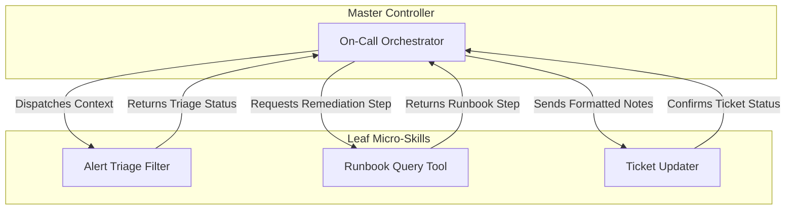

# Why I Ditched Spec-Driven Development for Micro-Skills

> Takeaway: Upfront specification documents stall agent development, whereas composable micro-skills restore immediate execution velocity.

*Caption: Modular terminal outputs restore developer velocity during active on-call shifts.*

Building an autonomous assistant during an active on-call rotation demands speed. Last week, I attempted to build an on-call copilot to automate ticket triage and incident runbook lookups. I started with Spec-Driven Development (SDD) to structure the entire system upfront. That choice immediately froze progress.

The Large Language Model (LLM) spent ten minutes digesting complex requirements and generated a six-page specification document. Sitting at my desk after a ten-hour shift, reading twenty sections of speculative design rules created instant cognitive fatigue. Instead of shipping code that handled production alerts, I was stuck reviewing theoretical text files.

## Why Upfront Specifications Stalled My On-Call Agent

Upfront specifications assume that software requirements remain static until code completion. With autonomous agents, prompt variations and Application Programming Interface (API) boundaries shift the moment tools hit live execution telemetry.

Analogy (manufacturing): Ordering a custom thirty-page blueprint for every standardized screw halts the assembly line while factory workers wait for paperwork.

When an LLM drafts monolithic specifications for small utilities, review fatigue kills developer momentum. The model invents edge cases for hypothetical interactions that never occur during live on-call rotations. I spent forty minutes verifying speculative state machines instead of testing alert parsing logic.

## The Pivot to Composable Micro-Skills

A micro-skill is an isolated executable tool with a dedicated parameter contract. Dropping the monolithic specification allowed me to build discrete capabilities one by one.

Each **micro-skill** handled a single operational duty without knowing anything about other tools. I built a ticket fetcher in fifteen minutes, validated its Command Line Interface (CLI) parameters, and moved to the log parser. Immediate execution feedback replaced hours of passive document verification.

## The Hub-and-Spoke Topology

Peer-to-peer agent tools quickly descend into chaotic communication paths. When five tools attempt to talk directly with each other, integration failures multiply exponentially across shared prompts.

I structured the on-call copilot using a strict hub-and-spoke topology. Child tools remain stateless leaf nodes that communicate exclusively with the master controller. The controller dispatches context, receives structured results, and directs downstream workflow steps.

This structural separation insulates leaf tools from blast radiuses when individual API calls fail. Replacing or tuning a log parser requires zero edits to the incident runbook tool.

## When Specifications Help Versus Hurt

Specifications are not useless, but applying them universally creates immense waste. Senior engineers must identify where formal contracts protect production systems and where they add bureaucratic drag:

1. Specifications are pure waste on leaf tools. A single tool signature and markdown instruction file provide the complete contract needed for execution.
2. Specifications deliver high leverage on shared system boundaries. Upstream systems of record and persistent database schemas require strict contracts to prevent data corruption.
3. Specifications become necessary during multi-tool composition failures. When runtime executions produce schema drift across controller handoffs, formal boundaries resolve contract mismatches.

| Architectural Dimension | Upfront Spec-Driven Development | Composable Micro-Skills |
| :--- | :--- | :--- |
| Primary Unit | Monolithic requirement document | Isolated leaf-node tool |
| Contract Enforcement | Multi-page text review before code | Input schema and tool signature |
| Review Fatigue | High cognitive drain on author | Instant feedback on live execution |
| Communication Pattern | Complex peer-to-peer dependencies | Strict hub-and-spoke orchestration |

## What to do next

Decompose monolithic agent prompts into bounded leaf tools with strict schemas. Route all inter-tool communication through a central master orchestrator to prevent integration sprawl. Reserve formal specification contracts for external boundaries where schema drift creates active runtime failures.
